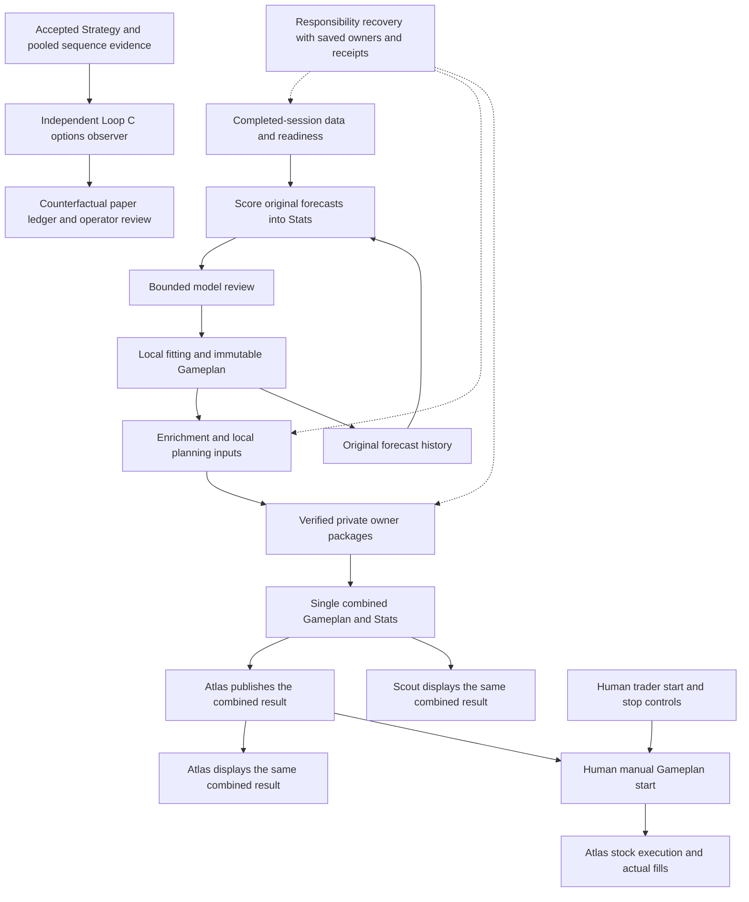

# Loops responsibility map

Current October 13 operating direction: every night Atlas and Scout each produce their own eleven-symbol Gameplan. Synthesize only those two Gameplans once with one actual cash and stock balance; return the same 22-symbol Gameplan and Stats to both PCs. Atlas may complete synthesis directly without a peer acceptance wait. Atlas runs the combined Gameplan trader and its own 15-minute trader; Scout runs only its own 15-minute trader. All three run and log independently. No cross-trader synthesis, reconciliation, verification, compatibility proof or approval is required. Nightly preparation is permanently authorized; the human manually starts each trader. See [independent traders](../development/independent-traders.md).

Solid arrows show dependencies, not automatic authority or a timetable. The
Loop C lane is independent of stock readiness and does not control the stock
worker. Independent stock horizons and the separate pooled encoder
retain their own contracts. Optional options/CME/ALFRED modules remain supported
inputs where the selected scope requires them.

See [Current system](CURRENT_SYSTEM.md) for October 11 Atlas task observations,
[relationships](LOOP_RELATIONSHIPS.md) for artifact boundaries and
[research onboarding](RESEARCH_SYMBOL_ONBOARDING.md) for explicit candidate
admission. Research selection and schedule installation do not start a trader.
