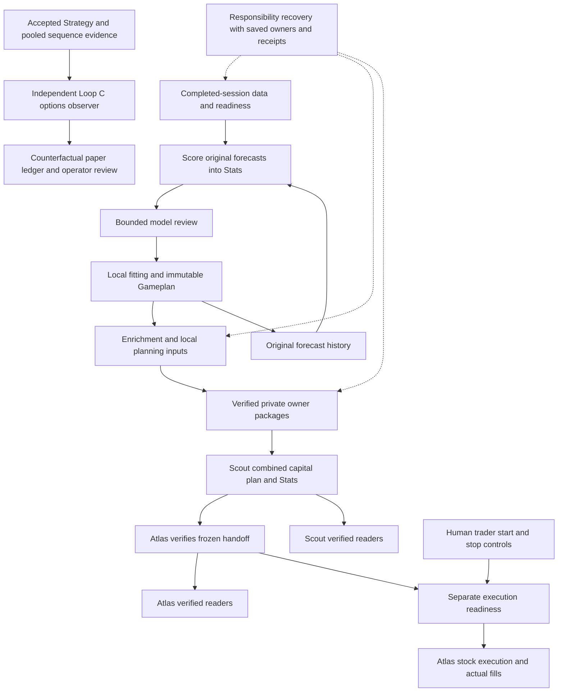

# Loops responsibility map

Solid arrows show dependencies, not automatic authority or a timetable. The
Loop C lane is independent of stock readiness and does not control the stock
worker. Independent stock horizons and the separate pooled encoder
retain their own contracts. Optional options/CME/ALFRED modules remain supported
inputs where the selected scope requires them.

See [Current system](CURRENT_SYSTEM.md) for October 11 Atlas task observations,
[relationships](LOOP_RELATIONSHIPS.md) for artifact boundaries and
[research onboarding](RESEARCH_SYMBOL_ONBOARDING.md) for explicit candidate
admission. Research selection and schedule installation do not start a trader.
